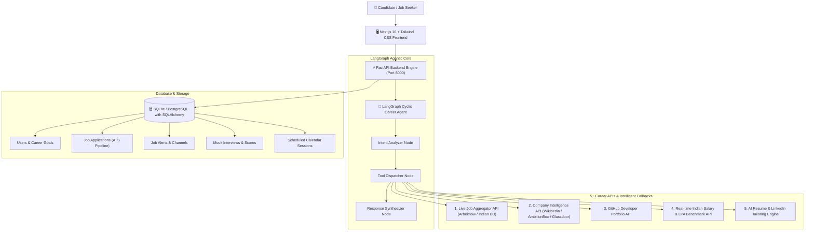

# 🚀 CareerCraft — AI Job Search & Autonomous Career Platform

[](https://github.com)
[](https://fastapi.tiangolo.com)
[](https://nextjs.org)
[](https://langchain-ai.github.io/langgraph/)
[](https://python.org)
[]()

A comprehensive, industry-ready **AI Career Development & Job Search Platform** built for the modern Tech Ecosystem.

---

## 📑 Table of Contents
- [Architecture Overview](#-architecture-overview)
- [Core Specialized Features](#-core-specialized-features)
- [Indian Job Market Specialization](#-indian-job-market-specialization)
- [5+ Career API Integrations with Fallback](#-5-career-api-integrations-with-fallback)
- [Database Schema](#-database-schema)
- [Setup & Installation](#-setup--installation)
- [Automated Testing & CI/CD](#-automated-testing--cicd)
- [API Reference](#-api-reference)

---

## 🏛 Architecture Overview



---

## ✨ Core Specialized Features

| Feature | Description | File / Route |
| :--- | :--- | :--- |
| **5+ Career APIs with Fallbacks** | Live job fetch, company culture, GitHub code analysis, LPA benchmarks, and AI resume tailoring with circuit breaker fallbacks. | `backend/app/services/career_apis.py` |
| **AI Mock Interview Arena** | Multi-domain technical question banks (AI, Full Stack, Backend), real-time scoring rubric, strengths/improvement feedback, and model answers. | `/interview`, `backend/app/api/interview.py` |
| **Salary Negotiation Coach** | Indian tax & in-hand monthly salary breakdown (LPA to Monthly formula) with counter-offer email generator and talking points. | `/interview#negotiate`, `interview.py` |
| **Skill Gap & Roadmap Engine** | Compares candidate skills against role benchmarks, calculates match %, and provides structured milestone roadmap. | `/interview#roadmap`, `roadmap.py` |
| **Calendar Scheduling** | Generates direct Google Calendar URLs and downloadable ICS event data for interview prep. | `/interview#schedule`, `interview.py` |
| **GitHub Portfolio Analyzer** | Live GitHub profile audit: public repos, language breakdown, star counts, and ATS code readiness score out of 100. | `/profile` (Tab 5), `career_apis.py` |
| **Role-Tailored Resume Engine** | Generates targeted resume bullets and LinkedIn headlines optimized for specific company job descriptions. | `ResumeAnalyzer.tsx`, `resume.py` |

---

## 🇮🇳 Indian Job Market Specialization

- **Compensation in LPA (Lakhs Per Annum)**: Auto-calculated with Metro vs Tier-2 city cost-of-living adjustments (Bengaluru +15%, Mumbai +10%, Tier-2 -20%).
- **Notice Period Handling**: Support for 0-day, 30-day, 60-day, and 90-day notice periods with buyout and immediate onboarding strategies.
- **Top Tech Hubs**: Filtered by Bengaluru, Mumbai, Pune, Hyderabad, Gurgaon/Delhi NCR, and Remote.
- **Company Culture Intelligence**: Realistic sentiment, work-life balance scores, and tech stacks for Indian employers (Swiggy, Zomato, Razorpay, Flipkart, TCS, Infosys, Google India, Microsoft IDC).

---

## 🔌 5+ Career API Integrations with Fallback

1. **Job Board API**: Live API queries external developer job feeds; automatically falls back to curated Indian tech market database if network times out or fails.
2. **Company Intelligence API**: Queries Wikipedia / Clearbit API with AmbitionBox & Glassdoor culture database fallback.
3. **GitHub Developer API**: Live GitHub API (`api.github.com/users/{username}`) extracting public repositories, languages, and star counts.
4. **Real-time Indian Salary Engine**: Calculates adjusted LPA compensation bands and in-hand monthly net take-home salary.
5. **AI Career Optimization Engine**: Dynamic ATS resume bullet points and LinkedIn headline/summary generator.

---

## 🛠 Setup & Installation

### Prerequisites
- Python 3.11+
- Node.js 18+ / 20+
- npm or pnpm

### 1. Backend Setup (FastAPI)
```bash
cd backend
python -m venv venv

# Windows:
venv\Scripts\activate
# Linux/macOS:
source venv/bin/activate

pip install -r requirements.txt
python main.py
```
> Server runs at `http://localhost:8000` (Swagger docs available at `http://localhost:8000/docs`).

### 2. Frontend Setup (Next.js)
```bash
cd frontend
npm install
npm run dev
```
> App runs at `http://localhost:3000`.

---

## 🧪 Automated Testing & CI/CD

Run the comprehensive unit test suite:
```bash
cd backend
python -m unittest discover -s tests -p "test_*.py"
```

CI/CD is automated via GitHub Actions in [`.github/workflows/ci.yml`](file:///.github/workflows/ci.yml):
- Python syntax compilation across all routers, services, and models.
- Execution of all 13 unit tests.
- Frontend ESLint linting and type checking.

---

## 📖 API Reference

| Method | Endpoint | Description |
| :--- | :--- | :--- |
| `POST` | `/api/auth/register` | Register new candidate |
| `POST` | `/api/auth/login` | JWT Login & token issuance |
| `GET` | `/api/auth/me` | Fetch candidate profile & goals |
| `POST` | `/api/resume/upload` | Upload PDF resume for ATS parsing |
| `POST` | `/api/resume/tailor` | Generate tailored resume & LinkedIn pitch |
| `POST` | `/api/agent/chat` | Chat with LangGraph Cyclic Career Agent |
| `GET` | `/api/agent/github-portfolio` | Live GitHub portfolio evaluation |
| `GET` | `/api/agent/company-intel` | Company intelligence & culture data |
| `GET` | `/api/agent/salary-benchmark` | LPA salary benchmark with Metro multiplier |
| `POST` | `/api/interview/start` | Start multi-question mock interview round |
| `POST` | `/api/interview/evaluate` | Evaluate technical answer with rubric |
| `POST` | `/api/interview/negotiate` | Calculate salary counter-offer & email draft |
| `POST` | `/api/interview/schedule` | Book mock interview & generate Google Calendar link |
| `GET` | `/api/interview/history` | List candidate mock interview scores |
| `GET` | `/api/interview/scheduled` | List upcoming scheduled sessions |
| `GET` | `/api/applications` | ATS job application tracker pipeline |
